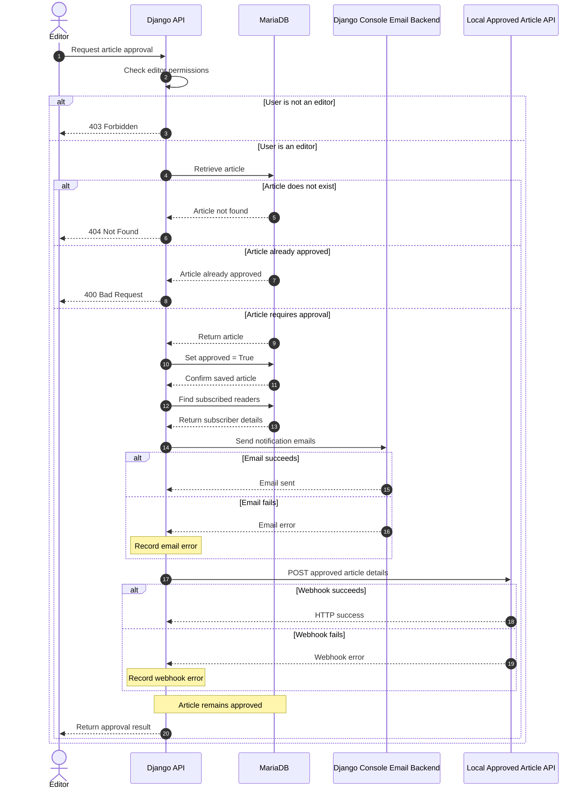
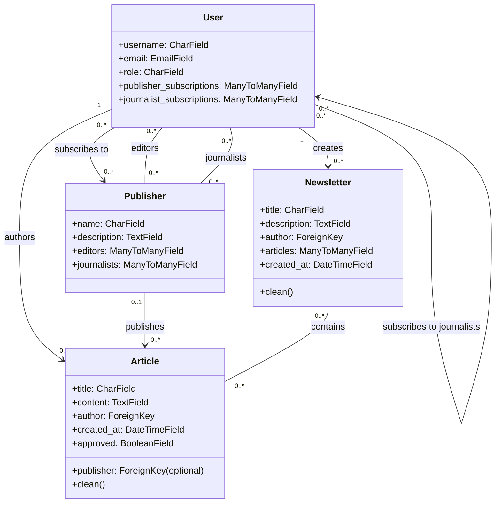

# News Application – System Design

## 1. Introduction

This document presents the system design for the News Application. It includes a use-case diagram, an article-approval sequence diagram and a class diagram.

The diagrams represent the application's three user roles, its main workflows and the relationships between its database models.

## 2. Use-Case Diagram

The use-case diagram shows the main activities available to Readers, Journalists and Editors.

## 3. Article Approval Sequence Diagram

This sequence diagram illustrates how an editor approves an article and how the application processes subscriber notifications and the webhook.

 

## 4. Class Diagram

The class diagram shows the main models and their relationships.

## 5. Design Explanation

### User roles

The application uses a custom Django user model with three roles: Reader, Editor and Journalist. Role-based permissions control which operations each user can perform.

### Article management

Journalists create articles. Articles are associated with a journalist and may optionally be linked to a publisher. Articles are initially unapproved and require editorial approval before appearing in the approved article listing.

### Subscriptions

Readers can subscribe to individual journalists and publishers. These relationships support the subscribed-articles API endpoint and subscriber notification processing.

### Newsletters

Journalists and Editors can create newsletters containing selected articles. The newsletter model uses a many-to-many relationship with articles because one newsletter can contain multiple articles.

### Database

MariaDB stores the application's users, publishers, articles and newsletters. Django ORM manages database relationships and migrations.

## 6. Conclusion

The design separates user responsibilities, content management and editorial approval. Django models represent the application's data, views and API endpoints handle application operations, and role-based permissions protect restricted functionality.

