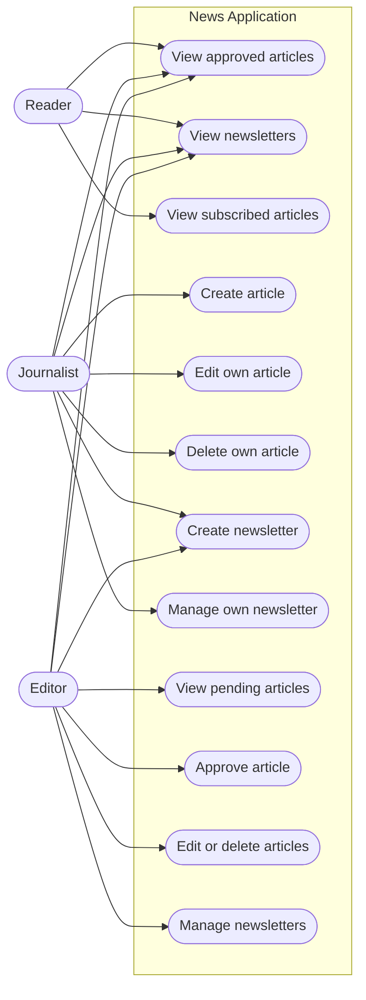
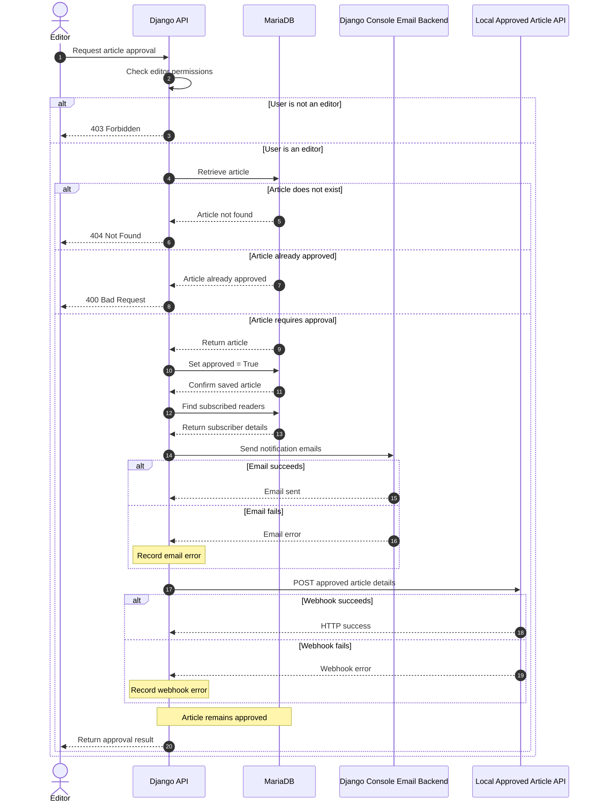
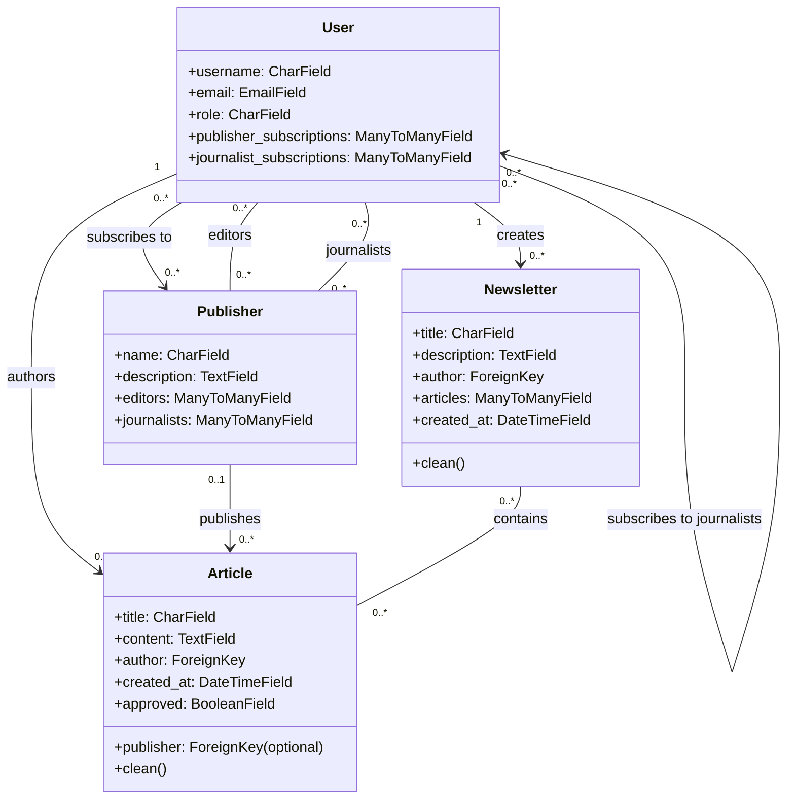

# News Application – System Design

## 1. Introduction

This document presents the system design for the News Application. It includes a use-case diagram, an article-approval sequence diagram and a class diagram.

The diagrams represent the application's three user roles, its main workflows and the relationships between its database models.

## 2. Use-Case Diagram

The use-case diagram shows the main activities available to Readers, Journalists and Editors.

## 3. Article Approval Sequence Diagram

This sequence diagram illustrates how an editor approves an article and how the application processes subscriber notifications and the webhook.

 

## 4. Class Diagram

The class diagram shows the main models and their relationships.

## 5. Design Explanation

### User roles

The application uses a custom Django user model with three roles: Reader, Editor and Journalist. Role-based permissions control which operations each user can perform.

### Article management

Journalists create articles. Articles are associated with a journalist and may optionally be linked to a publisher. Articles are initially unapproved and require editorial approval before appearing in the approved article listing.

### Subscriptions

Readers can subscribe to individual journalists and publishers. These relationships support the subscribed-articles API endpoint and subscriber notification processing.

### Newsletters

Journalists and Editors can create newsletters containing selected articles. The newsletter model uses a many-to-many relationship with articles because one newsletter can contain multiple articles.

### Database

MariaDB stores the application's users, publishers, articles and newsletters. Django ORM manages database relationships and migrations.

## 7. Functional Requirements

The News Application must provide the following functionality:

1. Users must be able to register and log in.
2. The system must distinguish between Readers, Editors and Journalists.
3. Journalists must be able to create and manage their own articles.
4. Articles must require editorial approval before publication.
5. Editors must be able to review, approve, update and delete articles.
6. Readers must be able to view approved articles and newsletters.
7. Readers must be able to subscribe to publishers and journalists.
8. The system must provide access to articles based on reader subscriptions.
9. Journalists and Editors must be able to create and manage newsletters.
10. The REST API must support authenticated article and newsletter operations.
11. The system must notify relevant subscribers when an article is approved.
12. The system must record and report the result of the approval webhook request.

## 8. Non-Functional Requirements

The application must also meet the following quality requirements:

- **Security:** Authentication and role-based permissions must protect restricted operations.
- **Data integrity:** Database relationships must maintain consistency between users, publishers, articles and newsletters.
- **Maintainability:** The application must use modular Django applications, models, views, serializers and forms.
- **Reliability:** The application must handle notification failures without preventing an article from remaining approved.
- **Usability:** The interface must provide clear navigation and understandable actions for each user role.
- **Performance:** Database queries should retrieve related information efficiently where appropriate.
- **Portability:** The application must support deployment using the documented Python, Django and MariaDB configuration.
- **Testability:** Automated tests must verify important application functions and access restrictions.

## 9. User Interface and User Experience Design

The application provides different functionality according to the user's role.

**Reader interface**

Readers can browse approved articles, view newsletters and access articles from subscribed journalists and publishers.

**Journalist interface**

Journalists can create articles, manage their own content and create or manage newsletters. Articles remain pending until an Editor approves them.

**Editor interface**

Editors can review pending articles, approve articles and manage articles and newsletters.

The interface uses Django templates and Bootstrap to provide consistent page layouts, navigation and forms.

Role-based access ensures that users are only permitted to perform operations appropriate to their responsibilities.

## 10. Database Design and Normalisation

The application uses Django ORM models and MariaDB to store information.

The main entities are User, Publisher, Article and Newsletter.

**User**

Stores account information, authentication details and the user's role. Subscription relationships connect readers to publishers and journalists.

**Publisher**

Stores publisher details and maintains relationships with its editors and journalists.

**Article**

Stores the article title, content, author, optional publisher, creation date and approval status. The author is linked to the User table, while the optional publisher is linked to Publisher.

**Newsletter**

Stores newsletter information and its author. A many-to-many relationship connects newsletters to articles, allowing a newsletter to contain multiple articles and an article to appear in multiple newsletters.

The design reduces unnecessary duplication by storing each main entity separately and linking related records through foreign keys and many-to-many relationships.

The use of Django ORM relationships supports referential integrity and allows the database structure to be maintained through migrations.

## 11. Conclusion

The system design provides a foundation for the News Application. It defines the user roles, application workflows, database relationships and system requirements. These design elements guide the implementation of the application and support its maintainability and functionality.
